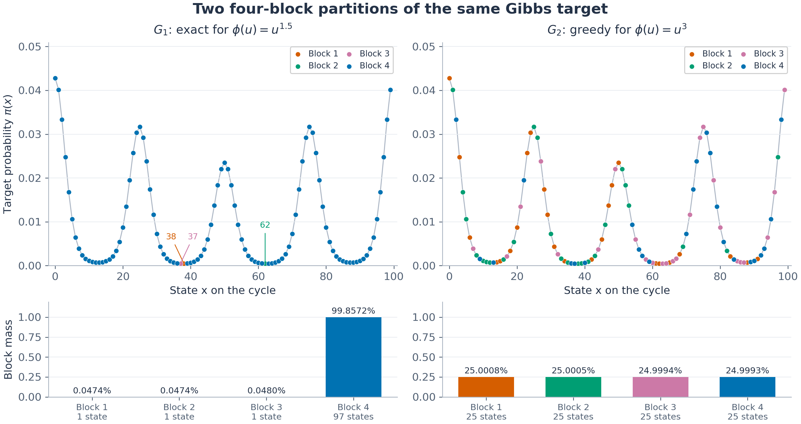

# Bregman projections and partition design for accelerating finite Markov chains

**Authors:** Michael C.H. Choi and Youjia Wang

**arXiv:** [TBD](TBD)

This repository contains the code for the experiments in the paper *Bregman projections and partition design for accelerating finite Markov chains*. 

